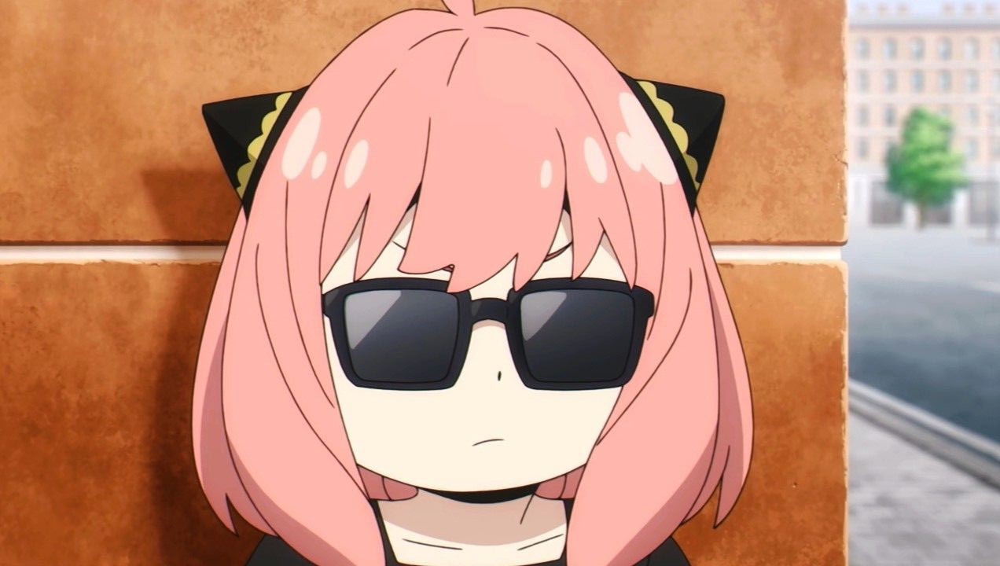

  

<table>
  <tr>
    <td colspan="2">
      <h3>Hi I'm Angel ✨</h3>
    </td>
  </tr>
  <tr>
    <td width="58%" valign="top">

**UI/UX Designer & Frontend Developer**

I'm based in The Netherlands and I love designing warm, thoughtful products, then building them myself, from the first sketch all the way to production.

Right now I'm pouring my energy into **Chefsey**, a home for food stories and recipes (think Substack for food). My playground is design systems, motion that feels alive, Figma, and the frontend code that makes it all real.

psst, the game on the right is real. tap a square and play with whoever visits next ✨

</td>
    <td width="42%" valign="top" align="center">

<!-- TTT:START -->

<b>let's play tic-tac-toe</b> 
it's ⭕'s turn · tap a square  
   
   
    
<b>recent moves</b> 
❌ <a href="https://github.com/nocaptainangel">@nocaptainangel</a>  
🏆 ❌ 0 · ⭕ 0 · 🤝 0

<!-- TTT:END -->

</td>
  </tr>
</table>

